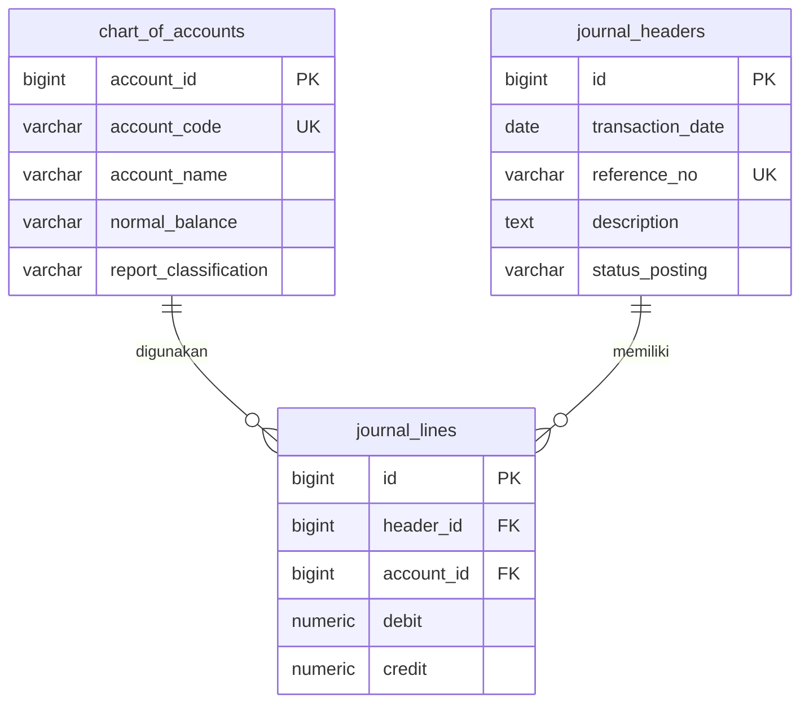

# Jawaban Soal 1

## 1.1 Perancangan skema relasional

Chart of accounts menyimpan identitas dan atribut akun. Journal headers menyimpan identitas transaksi dan statusnya satu kali. Journal lines menyimpan setiap alokasi debit atau kredit ke akun.

Satu baris harus merujuk tepat satu header dan satu akun. Akun dapat belum digunakan atau digunakan banyak baris. Header DRAFT dapat belum memiliki baris; header POSTED wajib memiliki minimal dua baris seimbang. Relasi header dengan akun secara konseptual many-to-many diselesaikan melalui journal_lines.

Asumsi: satu entitas dan satu mata uang IDR, ketelitian dua desimal, nomor referensi unik secara global. Jika nomor bukti hanya unik per jenis atau tahun, unique key perlu disesuaikan. ASSET, LIABILITY, EQUITY masuk laporan posisi keuangan; REVENUE dan EXPENSE masuk laba rugi. Saldo normal tetap atribut tersendiri untuk mengakomodasi akun kontra, misalnya akumulasi penyusutan berklasifikasi ASSET dengan saldo normal CREDIT.

## 1.2 DDL dan integritas

Kode lengkap ada pada sql/01_schema.sql. Primary key memberi identitas unik. Foreign key dengan ON DELETE RESTRICT mencegah penghapusan akun/header yang masih dirujuk. NOT NULL diperlukan karena CHECK yang menghasilkan NULL tidak menolak baris. NUMERIC digunakan agar perhitungan uang tidak mengikuti pendekatan floating point.

CHECK debit >= 0 AND credit >= 0 serta debit > 0 OR credit > 0 memenuhi persyaratan nominal soal. Tambahan debit = 0 OR credit = 0 memastikan satu baris hanya satu sisi. Penolakan NaN mencegah nilai numerik khusus lolos sebagai nominal akuntansi.

CHECK per baris tidak menjamin SUM(debit) = SUM(credit) antarbaris. sql/02_posting_guard.sql menambahkan trigger yang hanya memperbolehkan jurnal baru sebagai DRAFT, memeriksa minimal dua baris dan total debit = total kredit > 0 saat POSTED, lalu menolak perubahan header dan baris yang sudah POSTED. Draft boleh belum seimbang selama penyusunan; laporan buku besar hanya memakai jurnal POSTED.

Perubahan baris mengunci header dengan SELECT FOR UPDATE. Posting lewat UPDATE header memperoleh lock pada baris header yang sama. Gunakan transaksi pendek dengan isolasi READ COMMITTED; pada isolasi REPEATABLE READ/SERIALIZABLE aplikasi harus menangani kegagalan serialisasi dengan mengulang seluruh transaksi. Implementasi RPC dan pengaturan hak akses akan dibahas pada Soal 3. Trigger bukan perlindungan terhadap pemilik database yang dapat menonaktifkannya; role aplikasi tidak boleh memiliki kewenangan DDL, TRUNCATE, atau bypass pengamanan.

## 1.3 Audit trail dan 3NF

Dalam tabel jurnal datar, tanggal, nomor bukti, deskripsi, dan status header diulang untuk setiap baris. Mengubah deskripsi hanya pada sebagian baris menimbulkan update anomaly. Header tidak dapat disimpan sebelum alokasi tersedia tanpa nilai kosong atau baris semu, sehingga terjadi insertion anomaly. Menghapus baris terakhir dapat menghilangkan seluruh identitas transaksi, yaitu deletion anomaly.

Ketergantungan fungsional pada rancangan ini adalah account_id -> atribut akun, id header -> atribut transaksi, dan id baris -> header_id, account_id, debit, credit. Kode akun juga merupakan candidate key karena unik. Tidak ada atribut nama akun pada journal_lines atau atribut header yang diulang per baris. Dengan asumsi tidak ada ketergantungan bisnis tambahan antarattribut non-key, pemisahan ini memenuhi 3NF: atribut non-key bergantung pada key tanpa ketergantungan transitif pada non-key lain.

Auditor dapat menelusuri satu bukti melalui header ke seluruh baris dan akun, membandingkan jumlah debit-kredit, serta memeriksa status posting yang konsisten untuk seluruh transaksi. Pemisahan header-line mendukung audit trail, tetapi belum mencatat siapa yang melakukan perubahan atau nilai sebelum/sesudahnya. created_by, created_at, audit log, checksum, dan referensi jurnal pembalik pada Soal 3 diperlukan untuk melengkapinya. Perubahan nama/klasifikasi akun juga harus dikendalikan atau dicatat agar interpretasi laporan historis dapat ditelusuri.

## Referensi teknis

- PostgreSQL, Constraints: https://www.postgresql.org/docs/current/ddl-constraints.html
- PostgreSQL, Explicit Locking: https://www.postgresql.org/docs/current/explicit-locking.html

## Status validasi

DDL dan pengamanan posting sudah dipasang pada PostgreSQL Supabase 17.11. Pengujian posting dan akses pengguna terdokumentasi pada docs/hasil-pengujian.md; skrip terbaru pada tests/03_backend_tests.sql. Verifikasi browser/login nyata masih diperlukan.
